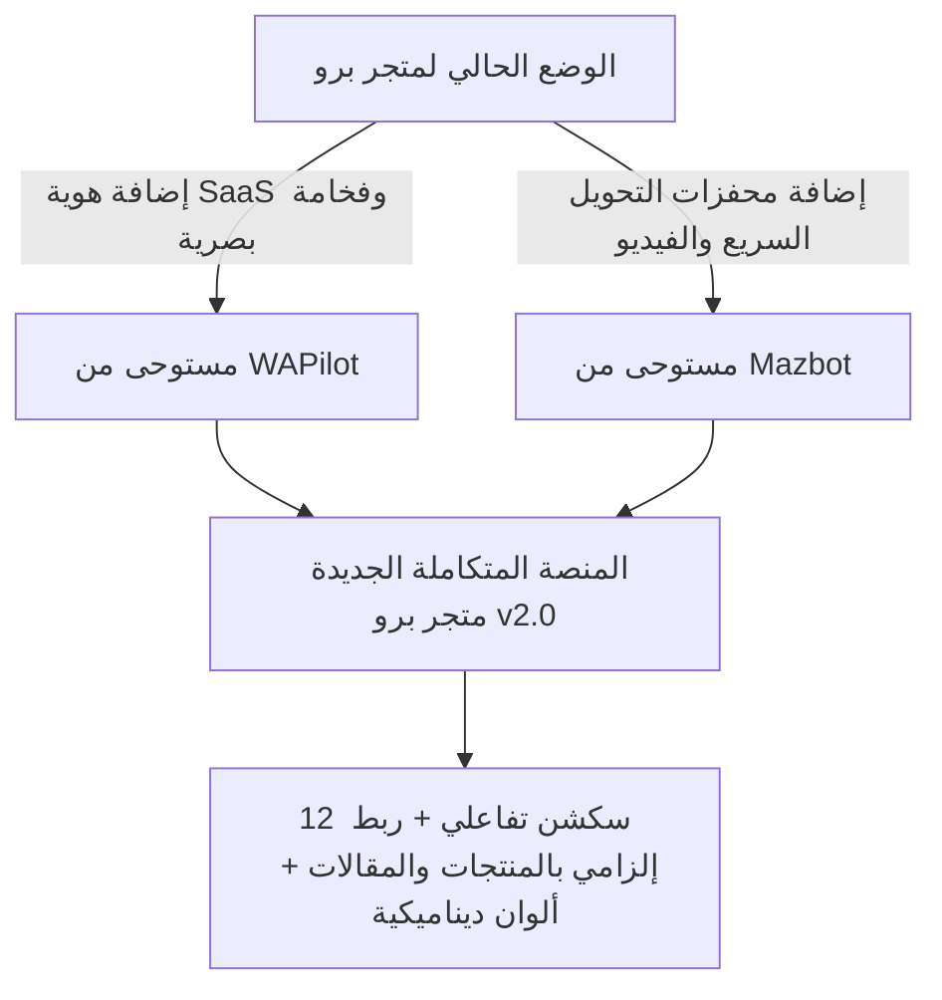
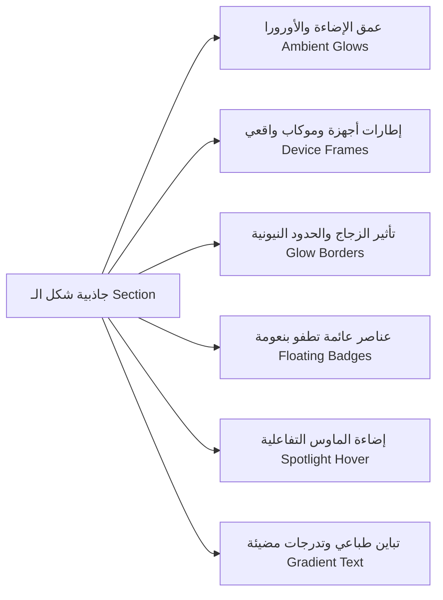
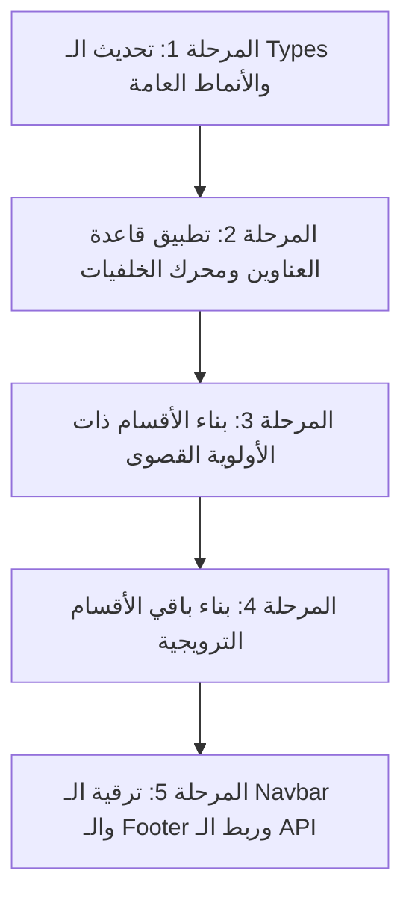

# وثيقة تطوير الهوية البصرية وخطة الأقسام الجديدة والتحكم في الهيدر والفوتر

> **مشروع:** منصة متجر برو (Matger Pro Storefront)  
> **مسار الملف في المشروع:** `SECTIONS_AND_DESIGN_PLAN.md`  
> **تاريخ الاعتماد والتحديث:** 2026-10-28  
> **الحالة:** وثيقة معتمدة ومرجع أساسي للتنفيذ والتطوير البرمجي  

---

## ⚠️ 1. القاعدة الصارمة الأساسية: منع العناوين الافتراضية (Zero Default Titles)

> [!IMPORTANT]
> **قاعدة ذهبية عامة تطبق على جميع الـ Sections الحالية والجديدة بلا استثناء:**  
> **إذا لم يُحدد عنوان للقسم (`section.title` غير موجود أو نص فارغ `""` أو مسافات فقط)، يظل العنوان فارغاً تماماً ولا يتم توليد أو إضافة أي عنوان افتراضي أو تلقائي نهائياً.**

### السلوك البرمجي المطلوب:
1. **منع الـ Fallbacks النصية إطلاقاً:**  
   * يُمنع استخدام: `section.title || (lang === 'ar' ? "وصل حديثاً" : "New Arrivals")`.  
   * يُمنع استخدام: `section.title || "الأكثر مبيعاً"` أو `section.title || "Latest Articles"`.
2. **إخفاء حاوية رأس القسم بالكامل (Hide Empty Headers):**  
   * إذا كان `section.title` فارغاً و `section.description` فارغاً، يتم إخفاء عنصر الـ `<div className={styles.sectionHeader}>` تماماً من الـ DOM، لتجنب ترك أي مساحات فارغة (White Space) تشوه التناسق البصري.
3. **تطبيق الفحص البرمجي القياسي:**
   ```tsx
   const titleText = typeof section.title === "string" 
     ? section.title.trim() 
     : (section.title?.[lang] || section.title?.ar || "").trim();

   const descText = typeof section.description === "string" 
     ? section.description.trim() 
     : (section.description?.[lang] || section.description?.ar || "").trim();

   const hasHeader = Boolean(titleText || descText);

   return (
     <section className={styles.sectionWrapper}>
       {hasHeader && (
         <div className={styles.sectionHeader}>
           {titleText && <h2 className={styles.sectionTitle}>{titleText}</h2>}
           {descText && <p className={styles.sectionSubtitle}>{descText}</p>}
         </div>
       )}
       <div className={styles.sectionContent}>
         {/* محتوى السكشن */}
       </div>
     </section>
   );
   ```

---

## 🔍 2. مقارنة مرجعية تحليلية شاملة: متجر برو vs. WAPilot vs. Mazbot

تم استخلاص أفضل ممارسات التحويل وتجارب المستخدم الرائدة من منصتي **WAPilot** و **Mazbot** لمعالجة النواقص في موقعنا الحالي:



| المحور / العنصر | موقع متجر برو الحالي | مرجع 1: WAPilot (`wapilot.net`) | مرجع 2: Mazbot (`mazbot.net`) | الترقية المعتمدة في متجر برو الجديد |
| :--- | :--- | :--- | :--- | :--- |
| **الهوية البصرية والعمق** | كروت مسطحة تقليدية وخلفيات رمادية مكررة | أسلوب Dark Tech SaaS فخم، أورورا مضيئة، زجاج بلوري | بساطة تركيزية، ألوان حيوية، بطاقات شطب أسعار بارزة | دعم 4 هويات جاهزة (Dark Tech, Clean Minimal, Luxury, Ecom) مع هالات ضوئية |
| **الهيرو (Hero)** | نصوص عادية مع سلايدر صور ثابتة | هيرو تفاعلي يضم لقطة شاشة متحركة للمنصة مع شارات إحصائيات | حقل سريع لطلب التجربة المباشرة | هيرو تفاعلي ذكي + موكاب هاتف/داشبورد + حقل رقم الواتساب المباشر |
| **شاشات ومزايا النظام** | صور صامتة ومجردة لا تؤدي لأي إجراء | شاشات توضيحية داخل إطارات أنظمة تشغيل عصرية | فيديو توضيحي حي يشرح الربط الفعلي | **معرض شاشات تفاعلي مربوط مباشرة بمنتجات للشراء أو مقالات بالمدونة + نقاط نابضة** |
| **تخفيف التردد (Friction)** | لا توجد مقارنة أو معالجة لمشاكل التجار | استعراض للميزات البرمجية والتكاملات | استعراض لمشاكل التجار (إهدار الوقت، ضياع العملاء) + شريط ثقة فوري | سكشن مشاكل التجار (`pain_point_agitation`) + سكشن مقارنة (`comparison_matrix`) + شريط الثقة |
| **الفيديو الترويجي** | غير متوفر حالياً | غير متوفر بالصفحة الرئيسية | فيديو مدمج يشرح المنصة عملياً مع زر تحويل فوري تحته | سكشن فيديو مدمج (`video_explainer_showcase`) مع زر تسجيل فوري |
| **استهداف الأنشطة التجارية** | عرض عام غير مخصص | تبويب بحسب حالات الاستخدام (Use Cases) | تصنيف قطاعات الأعمال (متاجر، مطاعم، عيادات، خدمات) | سكشن "لمن هذا النظام؟" (`target_audience_industries`) مع نماذج ديمو |
| **العروض والتخفيضات** | لا يوجد صندوق عرض محدود الوقت | أسعار شهرية وسنوية مباشرة | شريط عرض مغرٍ مع هدايا وشطب أسعار ومؤقت زمني | شريط العرض الترويجي والخصم الخاص (`urgency_offer_strip`) مع عد تنازلي |
| **شريط التنقل (Navbar)** | تقليدي ثابت | عائم زجاجي (`floating_pill`) | مباشر مع زر تواصل واتساب فوري | تحكم كامل: عائم زجاجي، إخفاء/إظهار السلة والحساب، زر واتساب مباشر |
| **التذييل (Footer)** | 3 أعمدة تقليدية | حديث مع تصنيفات منظمة | مقتضب مع شارات الأمان | تحكم كامل في الأعمدة (3/4/5)، شارات الدفع المعتمدة، التراخيص والسجل التجاري |
| **النشرة البريدية** | واجهة تجريبية تخزن البيانات في `useState` | ربط تسويقي مباشر | غير مستخدمة بالصفحة | **ربط رسمي مع الـ API والـ Backend + لوحة تحكم وإشعارات للإدارة وتصدير CSV** |
| **تنوع ألوان السكاشن** | خلفية بيضاء أو رمادية واحدة لكل الصفحة | خلفيات مظلمة متباينة بتوهجات زرقاء وخضراء | تباين بين الأبيض والألوان الترويجية | **محرك إيقاع الخلفيات الملونة (Color Rhythm Engine) مع تحكم كامل من الأدمن** |

---

## 🎨 3. نظام الهويات البصرية المتعددة (Theme Presets Engine)

لتلبية أذواق العملاء والأنشطة التجارية المختلفة بمرونة كاملة، تدعم المنصة 4 هويات بصرية جاهزة يمكن للتاجر أو مدير النظام اختيارها بضغطة زر من لوحة التحكم:

| الهوية البصرية | الطابع العام | نمط الألوان والخلفيات | الشريحة المستهدفة |
| :--- | :--- | :--- | :--- |
| **1. Dark Tech / SaaS** | فخامة تقنية مظلمة مستوحاة من WAPilot والمنصات العالمية | خلفية سوداء عميقة (`#0b0e14`) مع خطوط شبكية نيونية متوهجة (`Radial Mesh / Grid`)، وتدرجات خضراء زمردية أو بنفسجية كهربائية. | منصات الـ SaaS، المنتجات الرقمية، الخدمات السحابية، والشركات التقنية. |
| **2. Clean Minimalist** | ناصع، هادئ، وعصري فائق البساطة | مساحات بيضاء واسعة، حدود بطاقات خفيفة جداً، خطوط طباعية نقية، وظلال ناعمة (Soft Clay Shadows). | الشركات الاستشارية، المتاجر الطبية، مكاتب الأعمال، والحلول الإدارية. |
| **3. Luxury & Bold Gold** | ملكي، راقٍ، وفاخر | درجات الأسود الفاحم المدمجة مع تدرجات ذهبية وبرونزية عاكسة للضوء (Metallic Gold Accents). | العطور، الساعات، المجوهرات، الأزياء الراقية، والماركات الحصرية. |
| **4. Vibrant E-Commerce** | حيوي، عالي الطاقة والتحفيز | بطاقات ناصعة مع لمسات ألوان حيوية (أزرق ملكي، برتقالي مشرق، زمردي)، شارات خصم جذابة ومؤثرات حركية سريعة. | المتاجر الاستهلاكية، الإلكترونيات، الأزياء السريعة، وعروض التخفيضات. |

---

## ✨ 4. أسرار جاذبية وشكل الأقسام (Aesthetic Engineering & Wow-Factor Design)

> [!TIP]
> **مبدأ الإبهار البصري (Beyond Layout):**  
> العميل لا يقتنع بالمحتوى إلا إذا شعر أولاً بـ **الفخامة والانجذاب البصري**! تحويل الأقسام من مجرد "مربعات نصوص وصور مصفوفة" إلى **تحف بصرية حية وتفاعلية** يتطلب تطبيق 6 تقنيات تصميم متقدمة:



### 1. عمق الإضاءة والتوهجات الأورورا (Ambient Lighting & Aurora Mesh)
* لا توضع الكروت على خلفيات باهتة أو صلبة مملة؛ بل ندمج في خلفية السكشن **كرات إضاءة ضبابية عملاقة (Ambient Glowing Orbs)** بألوان الهوية:
  ```css
  .sectionGlowOrb {
    position: absolute;
    width: 500px;
    height: 500px;
    background: radial-gradient(circle, var(--accent) 0%, transparent 70%);
    filter: blur(140px);
    opacity: 0.15;
    pointer-events: none;
    animation: floatGlow 10s ease-in-out infinite alternate;
  }
  ```
* دمج **خطوط شبكية ثلاثية الأبعاد خافتة (Perspective Subtle Grid)** تعطي شعوراً بالمساحة والعمق التقني مثل منصات Stripe و WAPilot.

### 2. هندسة الكروت والحدود النيونية الزجاجية (Ultra Glass & Glow Borders)
* زوايا ناعمة وعصرية بنصف قطر (`border-radius: 20px` إلى `24px`).
* **إطار زجاجي مضيء خفيف:** بدلاً من الحدود الرمادية، نستخدم حافة شفافة تعكس الضوء مع لمسة داخلية علوية تعطي إحساس السُمك والبلور:
  ```css
  .attractiveCard {
    background: rgba(255, 255, 255, 0.03);
    backdrop-filter: blur(20px);
    border: 1px solid rgba(255, 255, 255, 0.08);
    box-shadow: 
      0 20px 40px -15px rgba(0, 0, 0, 0.5),
      inset 0 1px 0 rgba(255, 255, 255, 0.15); /* انعكاس زجاجي علوي */
    transition: all 0.4s cubic-bezier(0.16, 1, 0.3, 1);
  }
  .attractiveCard:hover {
    border-color: rgba(64, 163, 77, 0.4);
    box-shadow: 
      0 25px 50px -12px rgba(64, 163, 77, 0.15),
      inset 0 1px 0 rgba(255, 255, 255, 0.3);
    transform: translateY(-4px);
  }
  ```

### 3. إطارات الأجهزة الواقعية لشاشات النظام (Realistic Device Mockups)
* **منع الصور المسطحة العادية:** لا نعرض لقطة شاشة المتجر كصورة مستطيلة عادية، بل نضعها داخل:
  * **إطار هاتف ذكي فاخر (Mobile Chrome Frame):** مزود بزوايا دائرية، شاشة منحنية، جزيرة تفاعلية (Dynamic Island)، ولمعة انعكاس زجاجية مائلة عبر طبقة CSS Overlay.
  * **إطار متصفح داشبورد عالي الدقة (Desktop Browser Shell):** مزود بشريط علوي رمادي فاخر وأزرار التحكم الثلاثة (🔴 🟡 🟢) وعنوان URL يحمل اسم متجر التاجر (`yourstore.matger.pro`).

### 4. العناصر العائمة ذات الحركة الحرة (Floating Micro-Cards & Badges)
* حول شاشات النظام وبطاقات العرض، تطفو عناصر زجاجية صغيرة بحركة هادئة (`floatingKeyframes`) تعكس إثباتات سريعة:
  * شارة: *"✅ تم استلام طلب جديد #4829 بقيمة 450 ر.س"*
  * شارة: *"⚡ إشعار واتساب تلقائي أُرسل للعميل"*
  * شارة: *"📈 نسبة زيادة المبيعات +38%"*

### 5. إضاءة المؤشر التفاعلية (Mouse Spotlight Hover Effect)
* عند تحريك الماوس فوق بطاقات الميزات، تتبع الإضاءة حركة المؤشر (`Spotlight Border Effect`) مما يمنح إحساساً فائق الحداثة والتجاوب الحي مثل واجهات Apple و Vercel.

### 6. الأرقام المائية الخلفية والتايبوجرافي التناغمي (Watermark Typography)
* في سكاشن الخطوات أو المقارنة، نضع أرقاماً عملاقة باهتة في خلفية البطاقة (`01`, `02`, `03`) بشفافية 5% تعطي وزناً بصرياً وتوجيهاً لانسياب العين.
* استخدام تدرجات لونية مضيئة للنصوص المفتاحية (`background-clip: text; -webkit-text-fill-color: transparent`).

---

## 🌈 5. محرك إيقاع الخلفيات وتلوين السكاشن (Section Background & Color Rhythm Engine)

> [!IMPORTANT]
> **شرط التنوع البصري:**  
> منع الرتابة والمظهر الميت للموقع عبر إعطاء كل سكشن خيار خلفية مستقل من لوحة التحكم، مما يخلق تبايناً جذاباً بين أقسام الصفحة ويجعل الزائر يستمتع بالتمرير (Scroll Rhythm).

### أنماط الخلفيات المدعومة لكل سكشن:
1. **النمط الافتراضي للهوية (`theme_default`):** يتوارث خلفية الهوية البصرية المحددة للمتجر.
2. **التدرج اللوني المشع (`gradient_linear`):** تدرج لوني انسيابي ناعم بين درجتين متناسقتين بزاوية محددة.
3. **توهج الأورورا الشبكي (`mesh_glow`):** كرات ضوئية متدرجة تطفو خلف المحتوى بألوان هوية المتجر لتعميق الإحساس بالتقنية والفخامة.
4. **المسحة اللونية الهادئة (`subtle_tint`):** مسحة لونية شفافة وخفيفة جداً بنسبة 3% تكسر بياض أو سواد الصفحة برقة.
5. **شريط كسر التباين (`contrast_break`):** سكشن بلون داكن أو بلون الهوية الكامل لكسر روتين الصفحة ولفت الانتباه لأمر عاجل كالعروض أو الباقات.
6. **الشعاع المركزي الموضعي (`radial_spotlight`):** إضاءة دائرية مركزة في منتصف السكشن تسلط الضوء على المنتج أو شاشة النظام المعروضة.

### الفواصل الضوئية بين السكاشن (Section Glow Dividers):
* إمكانية تفعيل خط فاصل متوهج خفيف في أعلى أو أسفل السكشن بنمط `glow_line` أو تلاشي تدريجي `gradient_fade` يربط الأقسام بنعومة بدون خطوط قاطعة حادة.

```typescript
export interface SectionBackgroundConfig {
  type: 'theme_default' | 'solid' | 'gradient_linear' | 'mesh_glow' | 'subtle_tint' | 'contrast_break' | 'radial_spotlight';
  solidColor?: string; // كود لون مباشر
  gradientColors?: [string, string] | [string, string, string]; // ألوان التدرج
  gradientAngle?: number; // زاوية التدرج (مثل 135deg)
  glowColor?: string; // لون الهالة المشعة (مثل: "#40A34D" أو "#D4AF37")
  glowPosition?: 'top' | 'center' | 'bottom' | 'corners';
  hasPattern?: boolean; // تفعيل الشبكة الهندسية الخافتة
  dividerTop?: 'none' | 'glow_line' | 'gradient_fade';
  dividerBottom?: 'none' | 'glow_line' | 'gradient_fade';
}
```

---

## 🎛️ 6. إدارة السكاشن في لوحة تحكم الإدارة (Admin Panel Section Management)

> [!IMPORTANT]
> **شرط التكامل مع الإدارة (Zero Code Admin Control):**  
> أي سكشن جديد يتم بناؤه في الفرونت إند **يجب أن يظهر تلقائياً ويكون قابلاً للتحكم والتعديل الشامل من لوحة تحكم الإدارة** دون الحاجة لتعديل أي سطر برمجي في الموقع.

### أ. وظائف الإدارة في لوحة التحكم (Admin UI Capabilities)
1. **الترتيب التفاعلي بالسحب والإفلات (Drag & Drop Reordering):**
   * إمكانية إعادة ترتيب السكاشن في الصفحة الرئيسية بمرونة وسحب أي سكشن لأعلى أو لأسفل، وتحديث الموقع فوراً.
2. **مفتاح التفعيل والتعطيل الفوري (`Active / Inactive Toggle`):**
   * إظهار أو إخفاء أي سكشن (مثل إخفاء الباقات مؤقتاً أو إخفاء قسم المقارنة) بنقرة زر واحدة.
3. **إضافة سكشن جديد من قائمة جاهزة (`Add Section Modal`):**
   * قائمة منسدلة تحتوي على جميع أنواع السكاشن الـ 12 لاختيار وإضافة أي سكشن بضغطة زر.
4. **محرر إعدادات السكشن (Section Settings Drawer):**
   * **الحقول العامة:**
     * العنوان (`title`): حقل اختياري مع تنبيه واضح: *"اتركه فارغاً وسيختفي العنوان تماماً"*.
     * الوصف الفرعي (`description`): حقل اختياري.
     * نمط التخطيط (`displayMode`): مثل سلايدر، شبكة، أو تبويبات.
   * **محرر الخلفية والألوان (Color & Background Editor):**
     * اختيار نمط الخلفية (تدرج لوني، توهج مشع، مسحة ناعمة...) مع أداة منتقي الألوان (Color Picker) لاختيار الألوان بسهولة.
   * **محرر المحتوى الخاص بكل سكشن:**
     * ربط الشاشات والصور بالمنتجات أو المقالات واختيار معرّفات الـ Products والـ Posts بمرونة.

---

## 🧩 7. المخطط التفصيلي للأقسام الـ 12 الجديدة (The 12 New Sections Blueprint)

---

### القسم 1: الهيرو التفاعلي الحديث (`hero_saas_interactive`)

* **الهدف ومعدل التحويل:** خطف الانتباه في أول 3 ثوانٍ، تقديم إثبات بصري تفاعلي حي (Interactive Mockup)، وتقليل تردد العميل عبر تجربة حية بدون احتكاك.
* **تخطيط الواجهة (UI Layout):**
  * **الجهة الأولى (المحتوى الترويجي):**
    * شارة علوية للمصداقية (Trusted Badge): `Trusted by 1000+ businesses`.
    * عنوان رئيسي عريض (بدون عنوان افتراضي إذا لم يُحدد) مع تلوين كلمة مفتاحية متدرجة (Gradient Highlight).
    * وصف تسويقي مقنع ومقتضب.
    * **شريط الإجراء الفوري (Direct Lead Capture):** حقل إدخال مباشر لرقم الواتساب أو اسم المتجر + زر CTA سريع بتدرج مشع.
  * **الجهة المقابلة (الموكاب التفاعلي):**
    * هاتف ذكي ثلاثي الأبعاد أو شاشة تابلت تفاعلية تعرض متجراً حياً أو محاكي محادثة واتساب آلية.
    * **بطاقات إحصائيات عائمة (Floating Stat Pills):** كروت زجاجية عائمة على جوانب الموكاب مثل:
      * ⚡ *إطلاق المتجر: خلال 60 ثانية*
      * 📈 *معدل التحويل: +42%*
* **هيكل الـ Config البرمجي:**
```json
{
  "id": "hero_main",
  "type": "hero_saas_interactive",
  "title": "",
  "isActive": true,
  "config": {
    "trustedBadge": "موثوق من أكثر من 500+ تاجر",
    "headline": "أنشئ متجرك الإلكتروني الاحترافي في دقائق",
    "highlightWord": "بدون عمولة",
    "subheadline": "منصة متكاملة تدعم الشحن والدفع التلقائي والربط الذكي مع الواتساب",
    "quickInput": {
      "enabled": true,
      "type": "whatsapp_number",
      "placeholder": "أدخل رقم هاتفك للتجربة الفورية",
      "buttonText": "ابدأ الآن"
    },
    "mockupType": "interactive_store_phone",
    "floatingStats": [
      { "label": "إتمام الطلب", "value": "94%", "color": "green" },
      { "label": "زمن الإطلاق", "value": "دقيقتين", "color": "blue" }
    ]
  }
}
```

---

### القسم 2: شريط الثقة السريع بالأيقونات (`quick_trust_strip`) - [مستوحى من Mazbot]

* **الهدف ومعدل التحويل:** شريط خفيف ومدمج يوضع مباشرة أسفل الهيرو ليمنح العميل 4 ركائز أمان فورية تقضي على التردد قبل البدء في تصفح الموقع.
* **تخطيط الواجهة:**
  * شريط أفقي ناعم يضم نقاط القوة مفصولة بنقاط نيونية مشعة:
    `ربط رسمي معتمد • 0% عمولة على المبيعات • دعم فني على الواتساب 24/7 • استضافة سحابية فائقة السرعة`.
* **هيكل الـ Config البرمجي:**
```json
{
  "id": "trust_strip",
  "type": "quick_trust_strip",
  "title": "",
  "isActive": true,
  "config": {
    "items": [
      { "icon": "shield-check", "text": "ربط رسمي ومعتمد بنسبة 100%" },
      { "icon": "percent", "text": "0% عمولة على المبيعات" },
      { "icon": "whatsapp", "text": "دعم فني فوري 24/7" },
      { "icon": "zap", "text": "استضافة فائقة السرعة بلا انقطاع" }
    ]
  }
}
```

---

### القسم 3: معالجة المشكلة والألم للعميل (`pain_point_agitation`)

* **الهدف ومعدل التحويل:** تذكير التاجر بالمشاكل المرهقة التي يواجهها في الحلول التقليدية (Problem ➔ Agitation ➔ Solution) لإبراز منصتنا كحل حتمي.
* **تخطيط الواجهة (UI Layout):**
  * شارة تحذيرية بصرية خفيفة + عنوان صادم (مثل: *"إدارة الطلبات يدوياً تقتل نمو مبيعاتك"*).
  * 3 كروت زجاجية تستعرض المشاكل الكبرى:
    1. **ضياع العملاء:** بطء الرد وتشتت المحادثات يضيع 60% من المبيعات.
    2. **العمولات الباهظة:** المنصات تأكل هامش ربح التاجر مع كل طلب.
    3. **التعقيد البرمجي:** الحاجة الدائمة لمبرمجين وتكاليف صيانة باهظة.
* **هيكل الـ Config البرمجي:**
```json
{
  "id": "pain_section",
  "type": "pain_point_agitation",
  "title": "",
  "isActive": true,
  "config": {
    "badgeText": "المشكلة التي يواجهها معظم التجار",
    "highlightAlertWord": "تقتل نمو",
    "cards": [
      { "icon": "clock-alert", "title": "إهدار الوقت", "desc": "ساعات طويلة يومياً لتسجيل العناوين والرد على نفس الاستفسارات" },
      { "icon": "percent-cut", "title": "عمولات متراكمة", "desc": "اقتطاع نسب مئوية من كل عملية بيع ترهق ميزانيتك" },
      { "icon": "device-crash", "title": "أنظمة غير مستقرة", "desc": "تعطل المتاجر التقليدية وتأخر تحديث حالة الطلبات" }
    ]
  }
}
```

---

### القسم 4: المقارنة المباشرة - طريقتنا vs الطريقة القديمة (`comparison_matrix`)

* **الهدف ومعدل التحويل:** إزالة الشك وحسم القرار بمقارنة بصرية واضحة للفرق بين متجر برو والبدائل المعقدة.
* **تخطيط الواجهة (UI Layout):**
  * عمودين متجاورين في الشاشات الكبيرة (أو مكدسين في الموبايل):
    * **العمود الأول (الطريقة القديمة / المنصات الأخرى):** خلفية معتمة باهتة، أيقونات ✕ حمراء، ونقاط سلبية.
    * **العمود الثاني (مع متجر برو):** إطار نيون متوهج خفيف، أيقونات ✓ خضراء متألقة، وخلفية زجاجية فاخرة.
* **هيكل الـ Config البرمجي:**
```json
{
  "id": "compare_sec",
  "type": "comparison_matrix",
  "title": "",
  "isActive": true,
  "config": {
    "oldWayTitle": "البيع بالطرق التقليدية والمنصات المعقدة",
    "oldWayItems": [
      "عمولة على كل مبيعة تقتطع من أرباحك",
      "صعوبة في تفعيل الشحن وبوابات الدفع",
      "اعتماد كلي على المحادثات اليدوية والورقية",
      "دعم فني بطيء يتأخر لأيام"
    ],
    "newWayTitle": "مع منصة متجر برو",
    "newWayItems": [
      "0% عمولة - كامل أرباحك في جيبك",
      "بوابات دفع وشحن إلكتروني مجهزة ومفعلة فوراً",
      "إشعارات تلقائية للطلبات وحالات الشحن عبر الواتساب",
      "دعم فني مخصص وسريع على مدار الساعة"
    ]
  }
}
```

---

### القسم 5: معرض شاشات النظام التفاعلي المربوط بالمنتجات والمقالات (`system_screens_showcase`)

> [!IMPORTANT]
> **نقطة التركيز الجوهرية (Actionable System Screens):**  
> صور النظام وشاشات الاستعراض في هذا القسم **ممنوع أن تكون صوراً صامتة أو جمالية فقط**!  
> **كل شاشة نظام معروضة يجب أن ترتبط بشكل تفاعلي ومباشر بمنتج محدد من المتجر أو مقال ودليل تعليمي تفصيلي من المدونة.**

* **الهدف ومعدل التحويل:**
  * تحويل استعراض الشاشات ومميزات لوحة التحكم والمتجر إلى **قنوات مبيعات واكتساب مباشرة**.
  * إعطاء الزائر الدليل البصري الحي على سهولة النظام مع إمكانية تجربة أو شراء المنتج المرتبط فوراً، أو قراءة المقال الذي يشرح الميزة بعمق.

* **تخطيط الواجهة والجاذبية البصرية (UI Layout & Aesthetics):**
  1. **إطار الجهاز الواقعي (Realistic Device Chrome):**
     * عرض الشاشة داخل **إطار متصفح ماك بوك فاخر (Desktop Browser Shell)** بأزرار التحكم الملونة (🔴 🟡 🟢) أو **إطار هاتف آيفون ذكي (iPhone Frame)** بشاشة منحنية وانعكاسات زجاجية راقية.
  2. **النقاط التفاعلية النابضة على الصورة (Interactive Pulsing Hotspots):**
     * نقاط ضوئية تشع بنبضات حية (Pulsing Glow Pins) موضوعة على مناطق رئيسية داخل شاشة النظام (مثل: أيقونة إشعارات الواتساب، شريط الدفع التلقائي، تقرير المبيعات).
     * عند النقر أو التمرير على النقطة، ينبثق كارت زجاجي عائم يربط العميل فوراً بالمنتج أو المقال التابع لتلك الميزة.
  3. **لوحة الربط والتحويل الجانبية (Linked Conversion Panel):**
     * بجانب شاشة النظام تظهر بطاقة زجاجية فاخرة تتغير تلقائياً مع الشاشة المعروضة:
       * **في حال الارتباط بمنتج (`product`):** يظهر كارت المنتج المصغر متضمناً الاسم، السعر الأصلي، السعر بعد الخصم، وزر فوري: `🛍️ أضف للسلة` أو `اشتري الآن`.
       * **في حال الارتباط بمقال (`post`):** يظهر كارت المقال التعليمي متضمناً عنوان المقال، مدة القراءة، وزر مباشر: `📖 اقرأ الدليل التعليمي في المدونة`.
  4. **شريط تبويبات الشاشات التفاعلي (Interactive Tabs Bar):**
     * أزرار عائمة أعلى الشاشات بنمط كبسولات زجاجية متوهجة (`Glow Pills`) للتنقل السلس مع تأثير Fade & Zoom انسيابي.

* **هيكل الـ Config البرمجي:**
```json
{
  "id": "system_screens",
  "type": "system_screens_showcase",
  "title": "",
  "isActive": true,
  "config": {
    "displayMode": "device_slider",
    "deviceFrame": "desktop_mac",
    "screens": [
      {
        "id": "screen_dashboard",
        "tabLabel": "لوحة إدارة الطلبات",
        "imageUrl": "/images/system/dashboard_orders.png",
        "description": "تابع طلباتك ومبيعاتك لحظة بلحظة مع تحديثات فورية للمخزون",
        "targetType": "product",
        "productId": "prod_pro_plan",
        "buttonText": "اشترك في باقة المحترفين",
        "hotspots": [
          {
            "x": 35,
            "y": 60,
            "title": "الربط مع الواتساب",
            "targetType": "post",
            "postSlug": "how-to-automate-whatsapp-orders"
          }
        ]
      },
      {
        "id": "screen_mobile_checkout",
        "tabLabel": "صفحة الدفع السريع",
        "imageUrl": "/images/system/mobile_checkout.png",
        "description": "تجربة دفع في خطوة واحدة تدعم Apple Pay ومدى لزيادة مبيعاتك 35%",
        "targetType": "post",
        "postSlug": "boost-conversion-with-fast-checkout",
        "buttonText": "اقرأ دليل زيادة إتمام الطلبات"
      }
    ]
  }
}
```

---

### القسم 6: كيف يعمل المتجر في خطوات بسيطة (`process_steps_interactive`)

* **الهدف ومعدل التحويل:** تبسيط رحلة العميل وإشعاره بأن الانطلاق يحتاج دقائق معدودة فقط بدون أي عقبات برمجية.
* **تخطيط الواجهة (UI Layout):**
  * 3 إلى 4 خطوات ببطاقات مرقمة عصرية (`01`, `02`, `03`) بأرقام مائية متوهجة في الخلفية.
  * مؤشر بصري يوضح الخطوة النشطة مع إمكانية النقر لرؤية شرح الميزة.
* **هيكل الـ Config البرمجي:**
```json
{
  "id": "how_it_works",
  "type": "process_steps_interactive",
  "title": "",
  "isActive": true,
  "config": {
    "steps": [
      { "number": "01", "title": "سجل متجرك", "desc": "أدخل اسم متجرك ونشاطك بدون بطاقة بنكية" },
      { "number": "02", "title": "أضف منتجاتك", "desc": "حدد أسعارك وصورك وتصنيفاتك بسهولة" },
      { "number": "03", "title": "انطلق واستقبل الأموال", "desc": "شارك رابط متجرك وابدأ في استقبال الطلبات تلقائياً" }
    ]
  }
}
```

---

### القسم 7: سكشن الفيديو التوضيحي الحي (`video_explainer_showcase`) - [مستوحى من Mazbot]

* **الهدف ومعدل التحويل:** قطع الشك باليقين؛ فمشاهدة فيديو حقيقي لمدة دقيقة واحدة لشاشات النظام يرفع الثقة ومعدل التسجيل بأكثر من 80%!
* **تخطيط الواجهة والجاذبية البصرية (UI Layout & Aesthetics):**
  * مشغل فيديو responsive بنسبة 16:9 داخل إطار فخم بزوايا دائرية وظلال عميقة (`box-shadow: 0 18px 45px rgba(0,0,0,0.4)`).
  * يدعم تضمين فيديو YouTube أو Vimeo أو ملف MP4 مباشر.
  * **زر تحويل فوري أسفل الفيديو مباشرة (Watch-and-Convert CTA):** زر عريض بارز: *"سجّل مجاناً بعد ما تشوف الشرح"* يقتنص العميل فور انتهاء مشاهدة الفيديو.
* **هيكل الـ Config البرمجي:**
```json
{
  "id": "video_demo",
  "type": "video_explainer_showcase",
  "title": "",
  "isActive": true,
  "config": {
    "videoType": "youtube",
    "videoUrl": "https://www.youtube.com/embed/YOUR_VIDEO_ID",
    "posterImageUrl": "/images/video_thumbnail.jpg",
    "ctaButtonText": "سجّل مجاناً وابدأ تجربتك",
    "ctaButtonLink": "/signup",
    "aspectRatio": "16:9"
  }
}
```

---

### القسم 8: سكشن "لمن هذا النظام؟" وتصنيفات الأنشطة (`target_audience_industries`) - [مستوحى من Mazbot]

* **الهدف ومعدل التحويل:** التخصيص النفسي؛ عندما يرى التاجر نشاطه التجاري مذكوراً بالاسم (مثل: المتاجر الأونلاين، المطاعم، شركات الخدمات، تجار الجملة...) يشعر أن المنصة صُممت خصيصاً لاحتياجه.
* **تخطيط الواجهة (UI Layout):**
  * شبكة كبسولات زجاجية متوهجة تعبر عن الأنشطة التجارية المختلفة مع أيقونات ملونة.
  * إمكانية ربط كل نشاط بنموذج متجر ديمو جاهز للمعاينة الحية.
* **هيكل الـ Config البرمجي:**
```json
{
  "id": "target_audience",
  "type": "target_audience_industries",
  "title": "",
  "isActive": true,
  "config": {
    "subtitle": "حل متكامل مصمم خصيصاً لينمو مع نشاطك التجاري",
    "industries": [
      { "name": "المتاجر الإلكترونية", "icon": "shopping-bag", "demoLink": "/demo/store" },
      { "name": "البراندات وتجار الأزياء", "icon": "shirt", "demoLink": "/demo/fashion" },
      { "name": "شركات الخدمات والشحن", "icon": "truck", "demoLink": "/demo/services" },
      { "name": "المطاعم والكافيهات", "icon": "coffee", "demoLink": "/demo/food" },
      { "name": "العيادات والمراكز", "icon": "activity", "demoLink": "/demo/clinic" }
    ]
  }
}
```

---

### القسم 9: شريط العرض الترويجي والخصم الخاص (`urgency_offer_strip`) - [مستوحى من Mazbot]

* **الهدف ومعدل التحويل:** دفع المترددين نحو اتخاذ قرار فوري عبر عرض مغرٍ مع شطب الأسعار القديمة وهدية ترويجية.
* **تخطيط الواجهة (UI Layout):**
  * شريط أو صندوق بارز بلون ذهبي أو متدرج نابض بالحياة.
  * عرض الباقات مع الأسعار المشطوبة (Strikethrough Price: مثل `199$ ➔ 99$`).
  * شارة الهدية: `🎁 أول شهر مجاناً + دعم فني مجاني للربط مع الواتساب`.
  * إمكانية إضافة مؤقت عد تنازلي (Countdown Timer) للعروض محدودة المدة.
* **هيكل الـ Config البرمجي:**
```json
{
  "id": "promo_strip",
  "type": "urgency_offer_strip",
  "title": "",
  "isActive": true,
  "config": {
    "badgeText": "🎁 عرض حصري لفترة محدودة",
    "offerHeadline": "أول شهر مجاناً بالكامل + خصم 50% على جميع الباقات",
    "buttonText": "احصل على العرض الآن",
    "buttonLink": "/pricing",
    "showCountdown": true,
    "countdownEndsAt": "2026-11-30T23:59:59Z"
  }
}
```

---

### القسم 10: منظومة التكاملات والشركاء المعتمدين (`ecosystem_integrations`)

* **الهدف ومعدل التحويل:** بناء الثقة والأمان وإثبات جاهزية المتجر للعمل الفوري في السوق المحلي والإقليمي.
* **تخطيط الواجهة (UI Layout):**
  * تبويبات أو شريط متحرك انسيابي (Infinite Scrolling Marquee) لشعارات:
    * **الدفع الإلكتروني:** مدى، Apple Pay، فيزا، ماستركارد، تابي، تمارا، STC Pay.
    * **الشحن والتوصيل:** أرامكس، سمسا، سبل، بوليت، فاستلو.
    * **التسويق والأتمتة:** WhatsApp Business API، TikTok Pixel، Meta Pixel، Google Analytics.
* **هيكل الـ Config البرمجي:**
```json
{
  "id": "ecosystem_sec",
  "type": "ecosystem_integrations",
  "title": "",
  "isActive": true,
  "config": {
    "displayStyle": "tabs",
    "categories": [
      {
        "id": "payment",
        "name": "بوابات الدفع",
        "logos": ["mada", "apple_pay", "visa", "tabby", "tamara"]
      },
      {
        "id": "shipping",
        "name": "شركات الشحن",
        "logos": ["aramex", "smsa", "bosta", "spl"]
      }
    ]
  }
}
```

---

### القسم 11: سلايدر الباقات وحاسبة التوفير المتطورة (`pricing_saas_slider`)

* **الهدف ومعدل التحويل:** تشجيع الاشتراكات السنوية بمرونة وشفافية كاملة.
* **تخطيط الواجهة (UI Layout):**
  * مفتاح تبديل/سلايدر فترات الدفع: **شهري (Monthly) / نصف سنوي / سنوي (Yearly)** مع شارة: `خصم 20% 🎁`.
  * بطاقة الباقة المقترحة (Featured / Most Popular) مميزة بتوهج لوني عريض.
  * قائمة المزايا مدعومة بأيقونات خضراء واضحة، وزر اشتراك مباشر لكل باقة.
* **هيكل الـ Config البرمجي:**
```json
{
  "id": "pricing_sec",
  "type": "pricing_saas_slider",
  "title": "",
  "isActive": true,
  "config": {
    "defaultPeriod": "yearly",
    "yearlyDiscountBadge": "وفر شهرين مجاناً",
    "plans": [
      {
        "id": "starter",
        "name": "الباقة الأساسية",
        "monthlyPrice": 199,
        "yearlyPrice": 159,
        "features": ["متجر إلكتروني متكامل", "0% عمولة", "دعم الدفع الإلكتروني"],
        "isPopular": false,
        "buttonText": "ابدأ الآن"
      },
      {
        "id": "pro",
        "name": "الباقة الاحترافية",
        "monthlyPrice": 399,
        "yearlyPrice": 299,
        "features": ["كل مميزات الأساسية", "ربط تلقائي مع الواتساب", "تطبيق جوال خاص", "دومين مخصص مجاني"],
        "isPopular": true,
        "buttonText": "الاشتراك في باقة المحترفين"
      }
    ]
  }
}
```

---

### القسم 12: بانر الإغلاق والتحويل النهائي (`high_impact_cta_banner`)

* **الهدف ومعدل التحويل:** آخر فرصة لتحويل الزائر قبل مغادرة الموقع، مصمم بكثافة لونية جاذبة.
* **تخطيط الواجهة (UI Layout):**
  * كارت عريض بانورامي ممتد بألوان متدرجة حية (Vibrant Gradient Mesh).
  * هيدلاين قوي وعريض: *"مستعد لمضاعفة مبيعاتك اليوم؟"*
  * زر تحويل ضخم وعريض مع أيقونة سهم أو وميض يجذب النقر مباشرة.
* **هيكل الـ Config البرمجي:**
```json
{
  "id": "final_cta",
  "type": "high_impact_cta_banner",
  "title": "",
  "isActive": true,
  "config": {
    "headline": "ابدأ رحلة نجاح متجرك الإلكتروني اليوم",
    "subheadline": "انضم لمئات التجار الناجحين وابدأ تجربتك المجانية لمدة 14 يوماً",
    "buttonText": "أنشئ متجرك مجاناً الآن",
    "buttonLink": "/signup",
    "buttonGradient": ["#00B67A", "#008354"]
  }
}
```

---

## 🧭 8. نظام التحكم المتقدم في شريط التنقل (Navbar Control Engine)

لضمان تحكم الأدمن الكامل في مظهر ووظائف الـ Navbar من لوحة التحكم، نوفر كائن الإعدادات المخصص التالي:

```typescript
export interface NavbarAdvancedConfig {
  layoutStyle?: 'floating_pill' | 'full_width_glass' | 'solid_classic';
  scrollBehavior?: 'sticky' | 'hide_on_scroll_down' | 'static';
  showCart?: boolean;          // إظهار/إخفاء السلة (مفيد في وضع SaaS)
  showSearch?: boolean;        // إظهار/إخفاء البحث
  showAuth?: boolean;          // إظهار/إخفاء أزرار الدخول والتسجيل
  showThemeToggle?: boolean;   // إظهار/إخفاء مفتاح الوضع الليلي
  showLanguageSwitch?: boolean;// إظهار/إخفاء اختيار اللغة (عربي / English)
  primaryCta?: {
    show: boolean;
    text: string | LocalizedString;
    link: string;
    variant: 'solid' | 'gradient' | 'outline';
    gradientColors?: [string, string];
  };
  directWhatsApp?: {
    show: boolean;
    phoneNumber?: string;
    label?: string;
  };
  menuStyle?: 'dropdown' | 'mega_menu' | 'sidebar_drawer';
}
```

---

## ⚓ 9. نظام التحكم المتقدم في التذييل (Footer Control Engine)

يوفر كائن الإعدادات المخصص للـ Footer خيارات مرنة لتحديد محتوى ومظهر الفوتر:

```typescript
export interface FooterAdvancedConfig {
  layout?: '4_columns' | '3_columns' | '5_columns' | 'minimal_centered';
  showNewsletter?: boolean;
  newsletterTitle?: string | LocalizedString;
  newsletterSubtitle?: string | LocalizedString;
  showTrustBadges?: boolean;
  paymentIcons?: ('mada' | 'visa' | 'mastercard' | 'apple_pay' | 'tamara' | 'tabby')[];
  licenseInfo?: {
    showCommercialReg?: boolean;
    commercialRegNumber?: string;
    showTaxNumber?: boolean;
    taxNumber?: string;
    maroofBadgeUrl?: string;
  };
  showPolicies?: boolean;
  showSocialMedia?: boolean;
  backgroundStyle?: 'dark_mesh' | 'glass_blur' | 'solid' | 'brand_tinted';
}
```

---

## 📩 10. نظام النشرة البريدية وربطها التفاعلي مع الإدارة (Interactive Newsletter & Admin System)

> [!IMPORTANT]
> **شرط إلزامي: منع نماذج الاشتراك الشكلية (No Dummy Submissions)**  
> لا يجب إطلاقاً أن يكون الاشتراك في النشرة البريدية مجرد واجهة وهمية تخزن الحالة محلياً `useState` وتطبع رسالة شكر دون إرسال البيانات!  
> **بل يجب أن يكون هناك تفاعل حقيقي وتكامل مباشر مع نظام إدارة المتجر (Admin & Backend).**

### أ. دورة البيانات والاتصال بالـ Backend API
عند إدخال العميل لبريده والنقر على "اشتراك":
1. **التحقق من صحة المدخلات:** فحص صيغة البريد الإلكتروني ومنع إرسال الحقول الفارغة أو المكررة.
2. **إرسال طلب رسمي عبر الـ API:**
   ```typescript
   // استدعاء API حقيقي يرسل بيانات المشترك إلى السيرفر
   POST /api/v1/newsletter/subscribe
   Payload: {
     organizationId: "domansy",
     email: "user@example.com",
     source: "footer_newsletter",
     campaignAttribution: {
       utmSource: "google",
       campaignId: "black_friday_2026"
     },
     lang: "ar",
     subscribedAt: "2026-10-28T09:30:00Z"
   }
   ```
3. **حالات الواجهة التفاعلية الفورية (UI Interactive States):**
   * **أثناء الإرسال (Loading):** زر الاشتراك يتحول إلى مؤشر دوران (Loading Spinner) مع تعطيل الحقل لمنع الإرسال المزدوج.
   * **عند النجاح (Success):** ظهور رسالة شكر تفاعلية جميلة مع أيقونة احتفالية وكود خصم ترحيبي (مثل: *"شكراً لاشتراكك! استخدم كود WELCOME10 للحصول على خصم 10% على طلبك الأول"*).
   * **عند وجود خطأ (Error Handling):** إشعار العميل بلطف (مثل: *"هذا البريد مسجل لدينا بالفعل!"* أو *"حدث خطأ في الاتصال، يرجى المحاولة لاحقاً"*).

### ب. وظائف لوحة تحكم الإدارة (Admin Panel Management)
1. **سجل المشتركين المباشر (Subscribers Directory):**
   * جدول خاص في لوحة التحكم يعرض جميع المشتركين مع: تاريخ الاشتراك، مصدر التسجيل، وحالة البريد.
2. **تصدير القوائم التسويقية (Export to CSV / Excel):**
   * زر بضغطة واحدة لتحميل القائمة البريدية لاستيرادها في منصات التسويق (Mailchimp, Brevo, Resend).
3. **إشعارات فورية للإدارة (Admin Real-Time Alerts):**
   * إشعار تلقائي لمدير المتجر عبر البريد أو الداشبورد يفيد بـ: *"مشترك جديد انضم إلى قائمتك البريدية"*.
4. **الرد الآلي الترحيبي (Automated Welcome Email):**
   * إرسال بريد إلكتروني ترحيبي فوري للعميل يحتوي على بروفايل المتجر وأبرز المنتجات وكوبون ترحيبي.

---

## 🔗 11. ربط صور النظام والمزايا بالمنتجات والمقالات (System Images & Deep-Linking)

> [!IMPORTANT]
> **قاعدة إلزامية لصور النظام ومعارض المزايا (Actionable Visuals):**  
> صور النظام وشاشات الاستعراض (في أقسام `showcase`, `tabs_showcase`, `features`, `intro_slides`, و `hero_saas_interactive`) **يجب ألا تكون صوراً صامتة أو جمالية فقط**!  
> **بل يجب أن ترتبط بشكل تفاعلي ومباشر بمنتج من المتجر أو مقال ودليل تعليمي من المدونة.**

### أ. أنواع الربط المدعومة لكل صورة أو شريحة (Target Types)
1. **الربط مع منتج من المتجر (`targetType: "product"`):**
   * تحديد معرّف المنتج (`productId`).
   * عند النقر على الصورة أو زر الإجراء يتم توجيه العميل فوراً إلى صفحة المنتج `/store/[id]` أو فتح نافذة المعاينة السريعة للشراء المباشر.
   * **شارات المنتجات التفاعلية (Interactive Product Pins / Hotspots):** إمكانية وضع نقطة تفاعلية مضيئة أو شارة عائمة فوق الصورة تعرض اسم المنتج وسعره وزر "شراء الآن".
2. **الربط مع مقال من المدونة (`targetType: "post"`):**
   * تحديد الـ Slug أو معرّف المقال (`postSlug` / `postId`).
   * عند النقر على الصورة، يتم نقل العميل مباشرة إلى مقال الشرح التفصيلي في المدونة `/blog/[slug]` ليشرح له كيفية الاستفادة من الميزة أو قصة نجاح مرتبطة بها.
3. **الربط مع رابط مخصص (`targetType: "custom_url"`):**
   * توجيه العميل إلى رابط خارجي، صفحة اشتراك، أو استمارة تواصل محددة.

### ب. هيكل الـ TypeScript المقترح للمكونات (`types/index.ts`)
```typescript
export interface SystemShowcaseItem {
  id: string;
  label: string | LocalizedString;
  imageUrl: string;
  description?: string | LocalizedString;
  
  // الربط التفاعلي الإلزامي:
  targetType: 'product' | 'post' | 'custom_url';
  productId?: string;
  postSlug?: string;
  customUrl?: string;
  
  // زر الإجراء والشارات العائمة فوق الصورة:
  actionButton?: {
    show: boolean;
    text: string | LocalizedString; // مثل: "تصفح المنتج" أو "اقرأ الدليل الشامل"
  };
  floatingBadge?: {
    show: boolean;
    type: 'price_tag' | 'reading_time' | 'verified';
    text?: string;
  };
}
```

---

## 🚀 12. خارطة طريق التنفيذ البرمجي خطوة بخطوة (Step-by-Step Implementation Roadmap)



### المرحلة 1: أساسات الواجهة وهياكل البيانات (`src/types/index.ts` & `globals.css`)
1. إضافة تعريفات TypeScript للسكاشن الجديدة و `SectionBackgroundConfig` و `SystemShowcaseItem` و `NavbarAdvancedConfig` و `FooterAdvancedConfig`.
2. إضافة فئات CSS المساعدة للتوهجات الضوئية (`mesh_glow`, `gradient_linear`, `subtle_tint`) والفواصل الضوئية (`glow_divider`).

### المرحلة 2: تعديل محرك العرض وتطبيق قاعدة منع العناوين (`src/app/page.tsx`)
1. تنظيف كافة الـ Fallbacks النصية للعناوين (إذا لم يكتب التاجر عنواناً لا يتم عرض أي عنوان افتراضي).
2. تغليف كل سكشن بمكون الخلفيات التفاعلي الذي يقرأ `section.config?.background`.

### المرحلة 3: بناء أقسام التحويل ذات الأولوية القصوى
1. `SystemScreensShowcase.tsx`: معرض شاشات النظام مع إطارات الأجهزة والنقاط النابضة وروابط المنتجات والمقالات.
2. `HeroSaasInteractive.tsx`: الهيرو الحديث مع الموكاب التفاعلي وحقل الواتساب المباشر.
3. `ComparisonMatrix.tsx`: المقارنة الثنائية بين متجر برو والحلول التقليدية.
4. `VideoExplainerShowcase.tsx`: سكشن الفيديو المدمج بنسبة 16:9 مع زر التسجيل السريع.

### المرحلة 4: بناء باقي الأقسام الترويجية
1. `TargetAudienceIndustries.tsx`: سكشن تصنيف الأنشطة التجارية وروابط الديمو.
2. `UrgencyOfferStrip.tsx`: شريط العرض الترويجي والعد التنازلي.
3. `QuickTrustStrip.tsx`: شريط ركائز الأمان المدمج.
4. `PricingSaasSlider.tsx`: سلايدر الباقات وحاسبة التوفير.
5. `HighImpactCtaBanner.tsx`: بانر الإغلاق والتحويل النهائي.
6. `PainPointAgitation.tsx`: سكشن مشاكل الطرق التقليدية.
7. `ProcessStepsInteractive.tsx`: خطوات إطلاق المتجر (01, 02, 03).
8. `EcosystemIntegrations.tsx`: منظومة الشركاء والتكاملات.

### المرحلة 5: ترقية الـ Navbar والـ Footer وربط الـ API
1. تحديث `Navbar.tsx` ليدعم النمط العائم (`floating_pill`) ومفتاح الواتساب المباشر وإخفاء/إظهار السلة والحساب بحسب نوع المتجر.
2. تحديث `Footer.tsx` لدعم التحكم في عدد الأعمدة والشارات وتراخيص العمل.
3. ربط النشرة البريدية في الفوتر ومكون `NewsletterSignup.tsx` بـ API حقيقي على السيرفر مع حالات التحميل والنجاح والخطأ.

---

## 📌 ملخص والتزام نهائي

1. **الالتزام الصارم بقاعدة العنوان:** غياب عنوان القسم = عنوان فارغ تماماً بدون أي بديل افتراضي.
2. **التحكم الشامل من لوحة الإدارة:** كل سكشن جديد يظهر في لوحة التحكم لإدارته وترتيبه بالسحب والإفلات وتغيير ألوان خلفيته بحرية.
3. **الربط الفعلي للمزايا والشاشات:** كل شاشة نظام هي بوابة بيع مباشر لمنتج أو دليل تثقيفي في المدونة.
4. **النشرة البريدية التفاعلية:** ربط كامل بالـ Backend ولوحة الإدارة مع تسجيل حقيقي للمشتركين وتنبيهات فورية وحملات ترحيبية.
